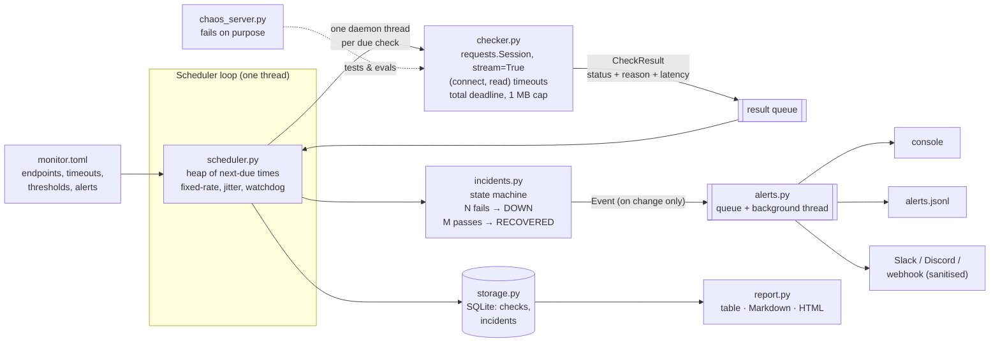

# api-health-monitor

[](https://github.com/paulmadojutimi94/api-health-monitor/actions/workflows/ci.yml)

**Point it at your APIs and it tells you, within a couple of check intervals, which one broke, how it broke, how long it was down, and what your real uptime is.**

> **Status:** v0.1. Python 3.11+, one dependency (`requests`). 57 tests. Classification, detection, latency, cost and attack evals all measured; CI re-checks classification and attacks on every push.

**Demo (3 min):** [docs/demo/api-health-monitor-demo.mp4](docs/demo/api-health-monitor-demo.mp4), narration script in [docs/DEMO.md](docs/DEMO.md).
**New to this?** [docs/LEARN.md](docs/LEARN.md) explains, from first principles, what actually happens when an API goes down, plus Requests, HTTP, scheduling and timeouts, with exercises.

## The problem

An API is a shop counter for software: your app walks up, asks for something, and expects an answer. When the counter is unstaffed, your app is the customer standing there. It won't complain; it'll just wait, and so will every customer behind it.

Your users notice first, and they tell you on social media. A health monitor is the mystery shopper who walks up to every counter every 30 seconds, times the service, checks they got the right thing, and phones the manager *only* when a counter is genuinely closed, not every time someone is slow to look up.

That last part is the hard bit. "Down" isn't one thing. Here's what the monitor sees for each kind of failure:

| What broke | What the monitor sees | How long until it knows |
|---|---|---|
| Server crashed, machine up | **Connection refused** | ~1 ms |
| Machine/network gone, firewall drops packets | **Connect timeout** (the handshake never finishes) | the connect timeout |
| App process frozen (deadlock, GC, thread pool exhausted) | **Read timeout** (connected, then silence) | the read timeout |
| App up, a dependency is down | **HTTP 500/502/503/504** | one round trip |
| Load balancer serving a "maintenance" page | **HTTP 200 with the wrong body**: a *silent* failure | one round trip, *only if you check the body* |
| Overloaded | **Slow** (still works, just past the latency SLO) | one round trip |
| DNS record deleted or expired | **Name doesn't resolve** | a DNS lookup |
| Certificate expired | **TLS error** | the handshake |
| Something trickling bytes forever | **Nothing**, unless you enforce a *total* deadline | forever, without the bonus lesson below |

## What it does

1. **Checks endpoints** with `requests`, on a schedule, each on its own interval.
2. **Measures latency**: time to first byte and total time, with reused connections, accurate to ~2 ms (p95).
3. **Detects failures** and names the cause: 15 distinct reasons, from `connection_refused` to `body_mismatch`.
4. **Sends alerts** to the console, a JSONL file, and Slack/Discord/any webhook, only when an endpoint *changes* state (3 failures in a row → DOWN, 2 successes → RECOVERED), so one blip never pages anyone and a 2-hour outage is two messages, not 240.
5. **Records uptime** in SQLite: every check, every incident, with uptime %, p50/p95 latency, downtime and mean time to recovery. Reports as a table, Markdown, or an HTML status page.
6. **Bonus: survives the endpoints it watches.** Hangs, slowloris drips, 50 MB bodies, gzip bombs, redirect loops and alert-injection attempts can't crash it, stall it, or make it page `@channel`.

```text
$ make demo
chaos server on http://127.0.0.1:PORT. Planted: payments 503 @6-14s, search maintenance @10-18s,
auth slow @4-12s then hang @18-25s, flaky-api fails 15%, slowloris drips forever.

[22:39:54] ALERT 🔴 DOWN slowloris | reason=deadline_exceeded | http=200 | latency=1603ms | detail=still receiving after 1.5s (9 bytes so far)
[22:39:56] ALERT 🟡 SLOW auth-api | reason=slow | http=200 | latency=601ms | detail=601 ms > SLO 400 ms
[22:39:57] ALERT 🔴 DOWN payments-api | reason=http_status | http=503 | latency=1ms | detail=HTTP 503 Service Unavailable
[22:40:01] ALERT 🔴 DOWN search-api | reason=body_mismatch | http=200 | latency=2ms | detail=expected text 'healthy' not in body
[22:40:03] ALERT ✅ FAST AGAIN auth-api | after 8s
[22:40:05] ALERT ✅ RECOVERED payments-api | after 9s
[22:40:09] ALERT ✅ RECOVERED search-api | after 8s
[22:40:11] ALERT 🔴 DOWN auth-api | reason=read_timeout | latency=1002ms | detail=ReadTimeout: ... Read timed out. (read timeout=1.0)
[22:40:16] ALERT ✅ RECOVERED auth-api | after 8s

Endpoint      Now   Uptime  Checks  p50 ms  p95 ms  Incidents  Downtime  MTTR
auth-api      up    88.09%  42      1       601     1          8s        8s
flaky-api     up    78.33%  60      1       1       0          0s        -
payments-api  up    73.33%  60      1       2       1          8s        8s
search-api    up    73.33%  60      1       2       1          8s        8s
slowloris     down  0.00%   15      -       -       1          30s       -

237 checks, 9 alert event(s), 0 watchdog rescues, 0 crashes
```

Every planted outage is caught with the right reason, `flaky-api` fails 15% of its checks at random and **never** pages anyone, and the planted 8-second outages are reported as 8–9 s. The search API returned `200 OK` throughout its outage: a monitor that only checked status codes would have called it 100% up.

## Architecture



Think of a hospital ward. The **scheduler** is the duty nurse with a list of who needs checking when, always looking at whoever is due next. She never waits by one bed: each check is handed to an assistant (a thread) so a difficult patient can't hold up the round. The **checker** is the assistant with a stopwatch and strict rules: wait at most 3 s for the door to open, 5 s of silence, 10 s in total, and don't accept a parcel bigger than 1 MB. The **incident tracker** is the senior doctor who won't call the family over one odd reading but will after three in a row. The **alert dispatcher** is the receptionist who makes the phone calls, so the nurse never stands on hold. The **store** is the chart at the foot of every bed.

Three decisions carry the design (the [design doc](docs/DESIGN.md) has the rejected alternatives):

- **Alert on state changes, not on failures.** The threshold table below shows why: alerting on a single failure gives 15–131 false alarms a day for an API that's just slightly flaky.
- **A check is bounded by three clocks, not one.** The connect timeout catches dead hosts, the read timeout catches frozen apps, and the total deadline catches the server that never stops talking, which the first two can't see. A fourth layer, the scheduler watchdog, catches the one case none of them can: headers trickling in forever.
- **Only the scheduler thread touches state.** Checks run in parallel, but results come back through a queue and are stored and judged by one thread, so SQLite and the state machine need no locks.

## Try it in one minute

```bash
git clone https://github.com/paulmadojutimi94/api-health-monitor && cd api-health-monitor
pip install requests                      # the only dependency
make demo                                 # 30 s: watch planted outages get caught
make report && open reports/status.html   # HTML status page from that run

cp monitor.example.toml monitor.toml      # then edit: your endpoints, your webhook
make check                                # check everything once (exit 1 if anything's down: use in CI)
PYTHONPATH=src python3 -m api_health_monitor run -c monitor.toml     # monitor until Ctrl-C
PYTHONPATH=src python3 -m api_health_monitor report --window 24      # uptime for the last 24 h
```

`pip install -e ".[dev]"` gives you an `api-health-monitor` command and the test tools.

## Eval results

All reproducible with `make eval` (about 5 minutes), which rewrites this section from `evals/results/`. CI fails if this section drifts from the results files, and re-measures classification and attacks on every push. Everything runs against a local server that fails on purpose (`chaos_server.py`), so every number is scored against a known answer.

<!-- results:start -->
| What | Result | How it was measured |
|---|---|---|
| **Failure classification** (single check names the right cause) | **100.0%** (300/300) | 15 failure types x 20 trials against a local server that fails on purpose |
| Up/down verdict correct | **100.0%** | Same 300 checks |
| **Outages detected** (recall) | **24 / 24** (100.0%) | 2 x 60 s live runs, 6 endpoints with random planted outages, 3,730 real checks |
| Alerts that were real (precision) | **96.0%** (24/25) | The one false alarm came from an endpoint failing 10% of checks at random |
| One-check blips that paged someone | **0 / 36** | Failures shorter than one check interval, which should never page |
| **Time to detect** | **p50 2.9, p95 6.6 check intervals** | Alert time minus planted start; rule is 3 failures in a row |
| Incident length error | p50 0.32 s, p95 0.77 s | Reported duration vs planted duration |
| **Latency measurement error** | **p50 1.63 ms, p95 2.14 ms** | Server sleeps 0-500 ms; measured minus injected, 150 checks |
| **Check latency (p50/p95)**, healthy endpoint | **0.48 / 0.71 ms** reused connection; 1.0 / 1.33 ms new | Localhost, so this is the monitor's own overhead |
| Slowest any check ever took | **1212 ms** with a 1,200 ms deadline | Includes hangs, slowloris, 50 MB bodies, gzip bombs |
| Scheduling under stress | **100.0%** of healthy checks on time, lateness p95 1.85 ms | 40 endpoints every 0.5 s, 15 of them hanging forever, peak memory 39.5 MB |
| **Cost per check** | **€0.00** in API fees; 0.527 ms CPU | 0.146 CPU-hours per million checks |
| **Attack success rate**, all defences on | **0 / 9** (0%) | 9 hostile-endpoint attacks, each in its own process with a 25 s kill switch |

| Defence switched off | Attacks that then succeed | What happened |
|---|---|---|
| Total deadline while reading the body | 1 / 1 | slowloris_body: hung > 25s |
| Connect/read socket timeouts | 1 / 1 | hang: hung > 25s |
| Scheduler watchdog | 1 / 1 | stuck check never reported DOWN |
| Body size cap (1 MB) | 2 / 2 | big_body: read 52 MB; gzip_bomb: read 105 MB |
| Redirect limit (5) | 1 / 1 | 10,001 requests, +476 MB memory |
| Sanitising server text before alerting | 2 / 3 | slack_mention got through; @everyone still blocked by allowed_mentions (2nd layer); terminal_escape got through |

**Alert threshold trade-off** (simulated: 30 days of 30-second checks per row, 400 planted outages per length, using the real state machine):

| Alert after N failures | False alarms/day at 0.5% / 2% / 5% random failure | 1-min outage caught | 5-min outage caught | Time to detect, p50 / p95 |
|---|---|---|---|---|
| 1 | 14.8 / 56.6 / 130.8 | 99.2% | 98.8% | 16 s / 28 s |
| 2 | 0.1 / 1.0 / 7.5 | 100.0% | 100.0% | 46 s / 58 s |
| 3 **(default)** | 0.0 / 0.0 / 0.5 | 1.8% | 100.0% | 75 s / 88 s |
| 4 | 0.0 / 0.0 / 0.0 | 0.0% | 100.0% | 105 s / 118 s |
| 5 | 0.0 / 0.0 / 0.0 | 0.0% | 100.0% | 135 s / 148 s |

Measured on Linux x86_64, Python 3.13.18.
<!-- results:end -->

How to read it:

- **Time to detect is mostly the threshold, by design.** With "3 failures in a row", the earliest possible alert is the 3rd check after the outage starts, i.e. ~2–3 intervals. The p95 of 6.6 intervals is outages of the *hang* type: each of those checks has to wait out its read timeout, and the scheduler won't start a second check on the same endpoint while one is running, so the effective interval stretches. On a real 30 s interval with a 5 s read timeout this is a few seconds, not minutes.
- **Precision 96% is the honest cost of the threshold.** The one false alarm was on an endpoint that fails 10% of checks at random: three in a row happens about once per 1,000 checks. The simulation table predicts exactly this rate, and is how you'd pick N for your own APIs.
- **The 1-minute row is a feature and a limitation.** With N = 3 on a 30 s interval, an outage must last ~90 s to page anyone. If a 1-minute outage matters to you, check more often rather than lowering N: halving the interval halves detection time without adding false alarms.
- **p50 / p95:** half of the checks were faster than p50, 95 in 100 faster than p95.
- **The ablation table is the point.** "0 attacks succeeded" could mean the attacks were weak. The second table switches off one defence at a time and shows its attacks getting through, including one check making 10,001 requests to a redirect loop. The Discord `@everyone` attack still fails with sanitising off because the payload *also* sets `allowed_mentions: none`: two layers on purpose.
- **Slowest check vs deadline:** the deadline is checked between reads, so it can overshoot by up to one gap between bytes (here ≤ 0.2 s). If that matters, lower the read timeout.

## Known failures

- **Header drip leaks a thread.** A server that sends headers 1 byte at a time never trips a socket timeout and never reaches the body loop where the deadline lives. The watchdog reports it DOWN on time, but Python can't kill a thread, so that one thread stays stuck until the server hangs up. It's bounded to one per endpoint (no new check starts while it's stuck), but it's a leak. A process-per-check design would fix it at ~30 ms per check (see the design doc).
- **Uptime is "share of checks that passed"**, not wall-clock time. With a 30 s interval, a 10 s outage between two checks is invisible, and one failed check counts as 30 s of downtime. The incident table gives the wall-clock view (first failure → recovery), within ±1 interval.
- **One vantage point.** If the monitor's own network breaks, every endpoint looks down at once. Real deployments run 3+ monitors in different regions and alert when a majority agree. Not built yet.
- **No TLS certificate-expiry warning.** An expired cert is caught (TLS error) the moment it expires, but there's no "expires in 14 days" alert yet.
- **DNS is cached by the OS**, so a deleted DNS record may only be noticed when the cache expires.
- **The default 1 MB body cap fails big healthy responses.** Point the monitor at a lightweight `/health` route, or raise `max_body_bytes`.
- **All numbers are from localhost.** They measure the monitor's own accuracy and overhead, not the internet. Latency against real APIs includes DNS, TLS and distance, which the monitor reports but these evals don't benchmark.
- **The alert queue lives in memory.** If the process is killed while Slack is down, queued alerts are lost (the JSONL file and SQLite still have them).

## Postmortem

**[Full write-up in docs/POSTMORTEM.md](docs/POSTMORTEM.md).** The headline incident:

- **What happened.** The demo's slowloris endpoint (1 byte every 0.2 s) was configured with a 1.5 s deadline, but was only reported DOWN after 3.5 s, and only because the scheduler watchdog stepped in. With the watchdog off, the check never returned.
- **How it was found.** The very first demo run. The alert said `previous check still stuck after 3.5s`, which is the watchdog's wording, not the checker's. That should have been impossible for a body drip.
- **Root cause.** The body loop used `resp.iter_content(16384)`, which waits until it has a *full* 16 KB chunk before handing anything back. At 5 bytes a second that's 55 minutes per chunk, so the "has the deadline passed?" check inside the loop never ran.
- **Fix and guard.** `resp.raw.read1(16384)`, which returns as soon as *any* bytes arrive. The deadline now fires at 1.6 s with no watchdog help; a unit test pins it at < 1.6 s, and the attack eval shows the slowloris attack succeeding the moment the deadline is switched off.

It also covers an outage whose length was understated by 3x after a single lucky check, a 44 ms latency "regression" that was really Nagle's algorithm, a test server that dropped connections exactly like an overloaded API, and hidden right-to-left characters in our own test file.

## Next steps

1. **Run it for a week against real APIs** from two regions, and add every surprise to the chaos server before changing code.
2. **Multi-region quorum:** only page when 2 of 3 monitors agree, so the monitor's own network can't cause an alert storm.
3. **Certificate-expiry and DNS checks** as their own check types ("cert expires in 14 days" is the easiest outage to prevent).
4. **Process-per-check option** for endpoints known to misbehave, closing the header-drip thread leak.
5. **Error budgets:** "99.9% this month means 43 minutes; you've used 31" is what a team actually acts on.
6. **Claude-written incident summaries, only if people read the alerts and still ask "so what happened?".** They'd get their own eval: accuracy against the incident record, cost per summary, p95 latency, and prompt-injection success rate, because endpoint responses are attacker-controlled text.

## Repo map

| Path | What's there |
|---|---|
| `src/api_health_monitor/` | The tool: eight small modules, one job each ([CLAUDE.md](CLAUDE.md) has the map) |
| `tests/` | 57 tests: every failure type, the state machine, alerts, storage, scheduler, CLI end to end |
| `evals/` | Classification, detection, threshold, performance and attack evals; `run_all.py` writes the tables above |
| `evals/results/` | The numbers those evals produced |
| `examples/` | Demo output, a Markdown report and an HTML status page from a real run |
| `monitor.example.toml` | Annotated config: copy to `monitor.toml` |
| `docs/LEARN.md` | What happens when an API goes down; Requests, HTTP, scheduling and timeouts, with exercises |
| `docs/DESIGN.md` | One-page design doc: decisions and the alternatives rejected |
| `docs/POSTMORTEM.md` | What went wrong and how it was found |
| `docs/CHEATSHEET.md` | Every line of the code explained, for technical interviews |
| `docs/DEMO.md`, `docs/demo/` | The 3-minute video, its timed script, and `make_video.py`, which rebuilds it from real output |
| `scripts/check_invisible_chars.py` | CI guard against hidden and right-to-left characters |
| `.github/workflows/ci.yml` | On every push, Python 3.11–3.13: lint, hidden-character check, tests, README check, evals, demo |
| `CLAUDE.md` | The guide for AI agents working in this repo |

MIT-licensed.
